# 基于springboot的社区团购系统设计

> 🎓 **计算机毕业设计 · 基于springboot的社区团购系统设计**
>
> 本仓库只放**项目介绍 + 运行截图**（截图是站点带水印的原图，存在仓库 `images/` 里）。
>
> 👉 **完整可运行源码 / 数据库脚本 / 部署文档：[点我获取](https://geekcode.top/archives/%E5%9F%BA%E4%BA%8Espringboot%E7%9A%84%E7%A4%BE%E5%8C%BA%E5%9B%A2%E8%B4%AD%E7%B3%BB%E7%BB%9F%E8%AE%BE%E8%AE%A1?utm_source=github)**
>
> 💬 咨询微信：**ir9372**　|　🌐 更多项目：[极客代码 geekcode.top](https://geekcode.top/?utm_source=github)
>
> 📌 项目详情页：<https://geekcode.top/archives/%E5%9F%BA%E4%BA%8Espringboot%E7%9A%84%E7%A4%BE%E5%8C%BA%E5%9B%A2%E8%B4%AD%E7%B3%BB%E7%BB%9F%E8%AE%BE%E8%AE%A1?utm_source=github>

<table><td width="230" align="center"> <b>扫码加微信 ir9372</b></td><td valign="middle">📦 源码 = 项目介绍 + 全部运行截图 + 数据库 + 部署文档 👉 点上方任意截图，直接跳到 <b>极客代码 geekcode.top</b> 详情页</td></table>

---

<h1>基于springboot的社区团购系统设计</h1>
<h2>项目概述</h2>

本项目为社区团购系统设计，面向社区团购场景，提供前台用户端与后台管理端。前台围绕商品信息、团购信息、社区信息展开，支持商品类型浏览、评论查看、购物车、我的订单、我的地址、我的收藏等功能；后台围绕运营与管理展开，支持用户、新闻、商品、商品类型、商品评论、团购、团购评论、社区、配置及轮播图管理。项目采用 Spring Boot、MyBatis-Plus、Shiro 与 Vue 集成架构，以 MySQL 存储业务数据，适合社区团购运营人员、消费者和后台管理员使用，实现社区团购业务的信息展示、交易辅助与内容管理。

<h2>技术架构</h2>
<h3>前后端架构</h3>

项目类型为 vue-integrated，即前端采用 Vue 技术并与后端进行集成。前台页面包括首页、登录页、注册页、商品信息列表、团购信息列表、社区信息列表、商品类型列表、购物车列表、个人中心、我的订单、我的地址、我的收藏、商品与团购评论列表及详情、商品与团购详情、社区详情等。后台页面包括后台登录页、后台首页、用户管理、商品信息管理、商品类型管理、团购信息管理、社区信息管理、商品信息评论管理、团购信息评论管理、新闻管理、配置管理、轮播图管理等。

后端基于 Spring Boot Web 提供接口能力，源码中可见的控制器包括 AddressController、CartController、CommonController、ConfigController、DiscussshangpinxinxiController、DiscusstuangouxinxiController、FileController、NewsController、OrdersController、ShangpinleixingController、ShangpinxinxiController、StoreupController。前端页面通过调用后端控制器提供的接口完成数据展示、业务操作和管理维护。

<h3>数据访问与数据库设计要点</h3>

数据访问层采用 MyBatis-Plus 与 MyBatis 相关依赖，结合 Spring Boot JDBC 配置访问 MySQL 数据库。系统业务数据围绕社区团购场景组织，可识别的主要数据对象包括用户、商品信息、商品类型、团购信息、商品评论、团购评论、新闻、配置、地址、购物车、订单、收藏、文件等。前台与后台截图中还体现了社区信息列表、社区信息详情以及后台社区信息管理，说明社区信息也是系统业务展示与管理内容的一部分。

数据库设计重点在于将社区团购业务中的内容信息、交易辅助信息和个人中心信息分开管理：商品、团购、社区、商品类型、新闻、配置、轮播图等内容信息支撑前台展示与后台运营；地址、购物车、订单、收藏等个人业务数据支撑用户端交易辅助；评论数据支撑商品与团购内容的互动展示。

<h3>核心技术选型理由</h3>
<table>
<thead>
<tr>
<th>技术组件</th>
<th>项目作用</th>
<th>选型理由</th>
</tr>
</thead>
<tbody><tr>
<td>Spring Boot</td>
<td>后端应用框架</td>
<td>提供 Web 开发、自动配置、内嵌容器和接口服务能力，便于快速搭建社区团购系统后端</td>
</tr>
<tr>
<td>MyBatis-Plus</td>
<td>数据访问与持久层框架</td>
<td>简化常见 CRUD 操作，适合商品、团购、评论、用户等后台列表管理场景</td>
</tr>
<tr>
<td>Shiro</td>
<td>认证与权限控制</td>
<td>用于系统登录认证和访问控制，适合后台管理入口与接口安全保护</td>
</tr>
<tr>
<td>Vue 集成前端</td>
<td>页面交互与展示</td>
<td>支持前台页面和后台管理页面构建，与 Spring Boot 后端形成完整 Web 应用</td>
</tr>
<tr>
<td>MySQL</td>
<td>关系型数据库</td>
<td>存储用户、商品、团购、评论、订单、地址、收藏、配置等业务数据</td>
</tr>
<tr>
<td>mysql-connector-java</td>
<td>数据库连接驱动</td>
<td>提供 Java 后端访问 MySQL 的驱动能力</td>
</tr>
<tr>
<td>commons-lang3</td>
<td>通用工具支持</td>
<td>为字符串、对象等基础处理提供工具能力</td>
</tr>
<tr>
<td>validation-api</td>
<td>数据校验支持</td>
<td>为接口参数校验和业务数据合法性检查提供基础能力</td>
</tr>
</tbody></table>
<h2>功能模块</h2>
<h3>前台用户端功能模块</h3>
<table>
<thead>
<tr>
<th>模块名称</th>
<th>功能描述</th>
</tr>
</thead>
<tbody><tr>
<td>首页入口</td>
<td>展示社区团购系统前台首页，提供商品信息、团购信息、社区信息等导航入口</td>
</tr>
<tr>
<td>用户注册与登录</td>
<td>提供前台用户注册和登录页面，用于进入个人中心及相关业务功能</td>
</tr>
<tr>
<td>商品信息浏览</td>
<td>展示商品信息列表和商品信息详情，支持查看商品相关内容</td>
</tr>
<tr>
<td>团购信息浏览</td>
<td>展示团购信息列表和团购信息详情，支持查看团购相关内容</td>
</tr>
<tr>
<td>社区信息浏览</td>
<td>展示社区信息列表和社区信息详情，支持查看社区相关内容</td>
</tr>
<tr>
<td>商品类型浏览</td>
<td>展示商品类型列表和商品类型详情，支持按商品类型查看相关信息</td>
</tr>
<tr>
<td>商品评论查看</td>
<td>展示商品信息评论列表和商品信息评论详情，用于查看商品相关评论内容</td>
</tr>
<tr>
<td>团购评论查看</td>
<td>展示团购信息评论列表和团购信息评论详情，用于查看团购相关评论内容</td>
</tr>
<tr>
<td>购物车</td>
<td>展示购物车列表，支持用户查看和管理购物车相关数据</td>
</tr>
<tr>
<td>个人中心</td>
<td>展示用户个人信息入口，连接我的订单、我的地址、我的收藏等功能</td>
</tr>
<tr>
<td>我的订单</td>
<td>展示当前用户的订单列表，用于查看订单相关信息</td>
</tr>
<tr>
<td>我的地址</td>
<td>展示当前用户的地址列表，用于查看和管理收货地址相关信息</td>
</tr>
<tr>
<td>我的收藏</td>
<td>展示当前用户的收藏列表，用于查看和管理收藏内容</td>
</tr>
</tbody></table>
<h3>后台管理端功能模块</h3>
<table>
<thead>
<tr>
<th>模块名称</th>
<th>功能描述</th>
</tr>
</thead>
<tbody><tr>
<td>后台登录</td>
<td>提供后台管理员登录入口，用于进入后台管理系统</td>
</tr>
<tr>
<td>后台首页</td>
<td>展示后台管理首页，作为后台各管理模块的入口</td>
</tr>
<tr>
<td>用户管理</td>
<td>对应后台用户管理路由，用于查看和维护系统用户数据</td>
</tr>
<tr>
<td>新闻管理</td>
<td>对应后台新闻管理路由，用于维护社区团购相关新闻资讯内容</td>
</tr>
<tr>
<td>商品信息管理</td>
<td>对应后台商品信息管理路由，用于维护商品信息数据</td>
</tr>
<tr>
<td>商品类型管理</td>
<td>对应后台商品类型管理路由，用于维护商品分类或商品类型数据</td>
</tr>
<tr>
<td>商品信息评论管理</td>
<td>对应后台商品信息评论管理路由，用于维护商品相关评论内容</td>
</tr>
<tr>
<td>团购信息管理</td>
<td>对应后台团购信息管理路由，用于维护团购活动或团购信息数据</td>
</tr>
<tr>
<td>团购信息评论管理</td>
<td>对应后台团购信息评论管理路由，用于维护团购相关评论内容</td>
</tr>
<tr>
<td>社区信息管理</td>
<td>后台社区信息管理页面用于维护社区相关内容数据</td>
</tr>
<tr>
<td>配置管理</td>
<td>对应后台配置管理路由，用于维护系统运行和展示相关配置</td>
</tr>
<tr>
<td>轮播图管理</td>
<td>后台轮播图管理页面用于维护首页或前台展示相关的轮播图内容</td>
</tr>
</tbody></table>
<h2>用户角色与权限</h2>
<table>
<thead>
<tr>
<th>角色</th>
<th>权限范围</th>
<th>可访问功能</th>
</tr>
</thead>
<tbody><tr>
<td>前台用户</td>
<td>面向社区团购消费者，主要使用前台展示、购物车、订单、地址、收藏等个人相关业务</td>
<td>首页、注册、登录、商品信息列表、商品信息详情、商品类型列表、商品类型详情、团购信息列表、团购信息详情、社区信息列表、社区信息详情、商品信息评论列表、商品信息评论详情、团购信息评论列表、团购信息评论详情、购物车列表、个人中心、我的订单、我的地址、我的收藏</td>
</tr>
<tr>
<td>后台管理员</td>
<td>面向系统运营和管理人员，主要使用后台管理页面维护业务数据、内容信息和系统配置</td>
<td>后台登录、后台首页、用户管理、新闻管理、商品信息管理、商品类型管理、商品信息评论管理、团购信息管理、团购信息评论管理、社区信息管理、配置管理、轮播图管理</td>
</tr>
</tbody></table>
<h2>项目特色与创新点</h2>
<ol>
<li>
<strong>围绕社区团购场景组织业务信息</strong> 系统将商品信息、团购信息和社区信息作为前台核心内容，形成面向社区团购场景的信息展示结构，便于用户浏览商品、团购活动和社区相关内容。

</li>
<li>
<strong>具备较完整的用户端业务辅助能力</strong> 前台用户端除基础信息浏览外，还提供购物车、我的订单、我的地址、我的收藏等个人中心功能，使用户能够围绕商品信息、团购信息和社区信息进行收藏、地址管理和订单查看等操作。

</li>
<li>
<strong>建立商品与团购评论展示体系</strong> 系统包含商品信息评论和团购信息评论的列表与详情页面，并在后台提供对应评论管理模块，便于展示评论内容和维护评论数据。

</li>
<li>
<strong>后台覆盖内容运营与基础配置管理</strong> 后台管理端不仅管理商品、团购、用户和评论，还包含新闻管理、社区信息管理、配置管理和轮播图管理，适合社区团购业务中的内容更新与运营维护。

</li>
<li>
<strong>技术组合贴合毕业设计项目实践</strong> 项目采用 Spring Boot、MyBatis-Plus、Shiro、Vue 集成前端和 MySQL 数据库，覆盖 Web 开发、数据访问、权限控制、前端页面展示和关系型数据存储，技术结构完整，适合用于计算机专业毕业设计实现。

</li>
</ol>
<h2>部署环境</h2>
<table>
<thead>
<tr>
<th>环境项</th>
<th>说明</th>
</tr>
</thead>
<tbody><tr>
<td>JDK</td>
<td>用于运行 Spring Boot 后端应用，具体版本需与项目配置保持一致，上下文中未提供明确版本</td>
</tr>
<tr>
<td>MySQL</td>
<td>用于存储系统业务数据，项目依赖 mysql-connector-java 作为数据库连接驱动，具体版本需与项目配置保持一致</td>
</tr>
<tr>
<td>Node.js</td>
<td>项目类型为 vue-integrated，前端资源构建通常需要 Node.js 环境，具体版本需与项目前端工程配置保持一致</td>
</tr>
<tr>
<td>Spring Boot Web 容器</td>
<td>后端基于 spring-boot-starter-web 提供 Web 服务能力，可通过 Spring Boot 应用启动方式运行</td>
</tr>
<tr>
<td>数据访问组件</td>
<td>使用 mybatis-spring-boot-starter、spring-boot-starter-jdbc、mybatis-plus、mybatisplus-spring-boot-starter 等依赖完成数据库访问</td>
</tr>
<tr>
<td>安全认证组件</td>
<td>使用 shiro-spring 提供认证和权限控制能力</td>
</tr>
<tr>
<td>工具与校验组件</td>
<td>使用 commons-lang3、validation-api、protobuf-java 等依赖提供工具支持和数据校验支持</td>
</tr>
<tr>
<td>浏览器</td>
<td>前台用户端和后台管理端可通过 Chrome、Edge 等现代浏览器访问</td>
</tr>
<tr>
<td>数据库准备</td>
<td>系统运行前需要配置 MySQL 数据库连接，并准备商品、团购、社区、评论、用户、订单、地址、收藏、配置、轮播图等业务数据，具体初始化脚本以项目源码为准</td>
</tr>
</tbody></table>
<h2>五、技术特性</h2>
<ul>
<li>前后端集成部署，前端资源打包至后端 static 目录</li>
<li>使用 MyBatis-Plus 简化数据访问层开发</li>
<li>集成 Shiro 权限框架实现角色权限控制</li>
</ul>
<h2>六、功能模块截图</h2>
<h3>前台用户端</h3>
<h4>前台首页</h4>

<a href="https://geekcode.top/archives/%E5%9F%BA%E4%BA%8Espringboot%E7%9A%84%E7%A4%BE%E5%8C%BA%E5%9B%A2%E8%B4%AD%E7%B3%BB%E7%BB%9F%E8%AE%BE%E8%AE%A1?utm_source=github" title="查看完整源码">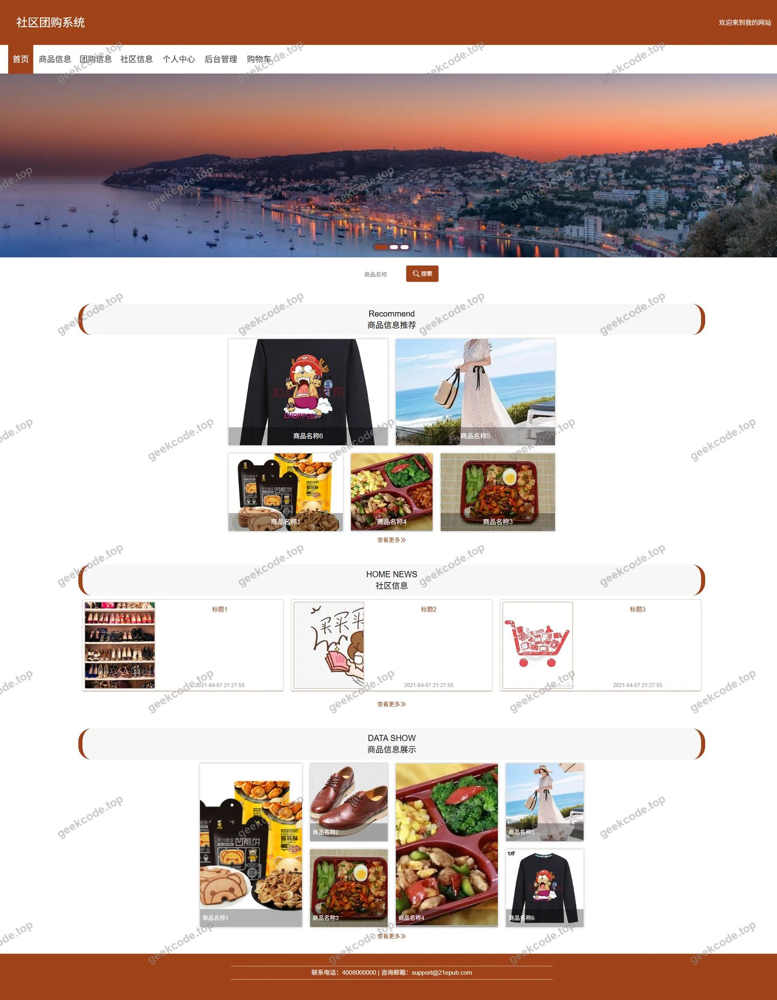</a>

<h4>前台登录页</h4>

<h4>前台注册页</h4>

<a href="https://geekcode.top/archives/%E5%9F%BA%E4%BA%8Espringboot%E7%9A%84%E7%A4%BE%E5%8C%BA%E5%9B%A2%E8%B4%AD%E7%B3%BB%E7%BB%9F%E8%AE%BE%E8%AE%A1?utm_source=github" title="查看完整源码">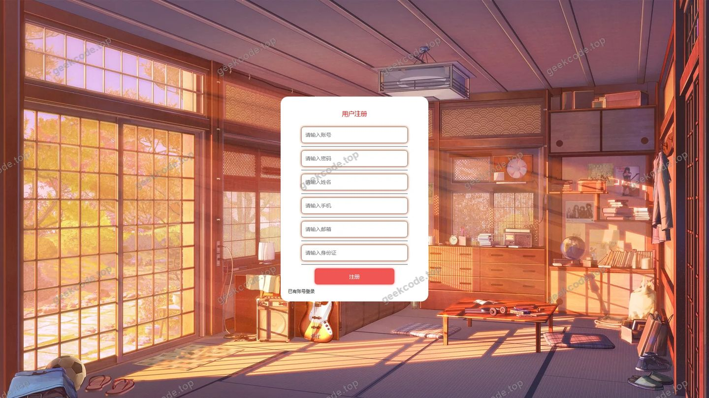</a>

<h4>前台-社区信息列表</h4>

<a href="https://geekcode.top/archives/%E5%9F%BA%E4%BA%8Espringboot%E7%9A%84%E7%A4%BE%E5%8C%BA%E5%9B%A2%E8%B4%AD%E7%B3%BB%E7%BB%9F%E8%AE%BE%E8%AE%A1?utm_source=github" title="查看完整源码">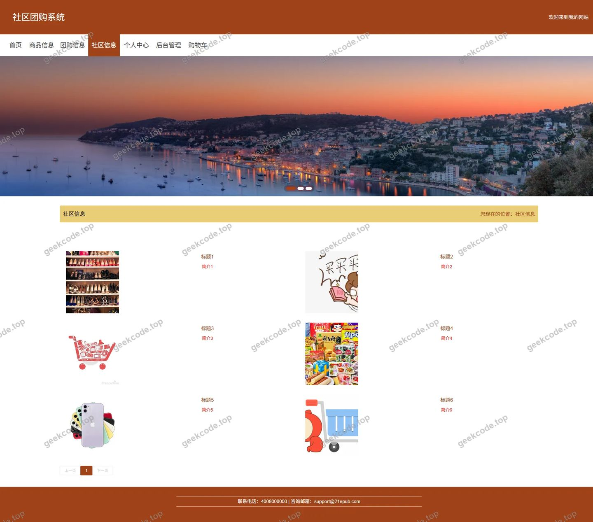</a>

<h4>前台-商品信息列表</h4>

<h4>前台-团购信息列表</h4>

<h4>前台-商品信息评论列表</h4>

<h4>前台-团购信息评论列表</h4>

<h4>前台个人中心</h4>

<a href="https://geekcode.top/archives/%E5%9F%BA%E4%BA%8Espringboot%E7%9A%84%E7%A4%BE%E5%8C%BA%E5%9B%A2%E8%B4%AD%E7%B3%BB%E7%BB%9F%E8%AE%BE%E8%AE%A1?utm_source=github" title="查看完整源码">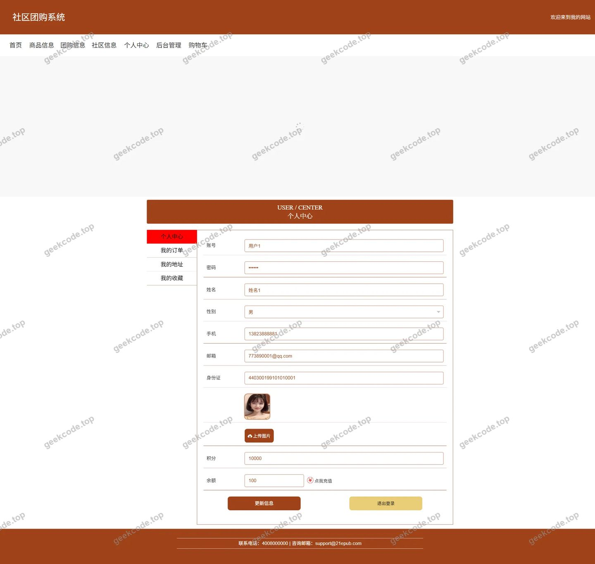</a>

<h4>前台-我的地址列表</h4>

<a href="https://geekcode.top/archives/%E5%9F%BA%E4%BA%8Espringboot%E7%9A%84%E7%A4%BE%E5%8C%BA%E5%9B%A2%E8%B4%AD%E7%B3%BB%E7%BB%9F%E8%AE%BE%E8%AE%A1?utm_source=github" title="查看完整源码">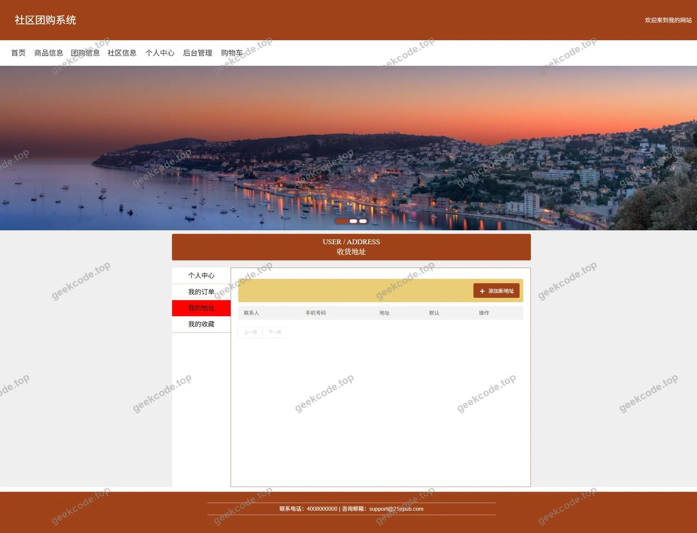</a>

<h4>前台-我的订单列表</h4>

<h4>前台-我的收藏列表</h4>

<h4>前台-社区信息-详情</h4>

<h4>前台-商品信息-详情</h4>

<a href="https://geekcode.top/archives/%E5%9F%BA%E4%BA%8Espringboot%E7%9A%84%E7%A4%BE%E5%8C%BA%E5%9B%A2%E8%B4%AD%E7%B3%BB%E7%BB%9F%E8%AE%BE%E8%AE%A1?utm_source=github" title="查看完整源码">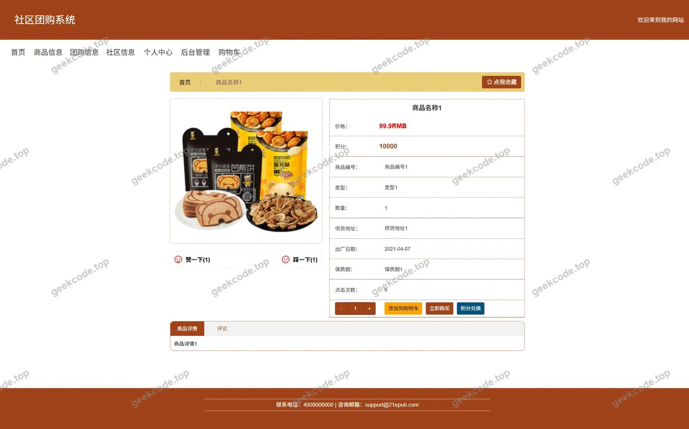</a>

<h4>前台-团购信息-详情</h4>

<a href="https://geekcode.top/archives/%E5%9F%BA%E4%BA%8Espringboot%E7%9A%84%E7%A4%BE%E5%8C%BA%E5%9B%A2%E8%B4%AD%E7%B3%BB%E7%BB%9F%E8%AE%BE%E8%AE%A1?utm_source=github" title="查看完整源码">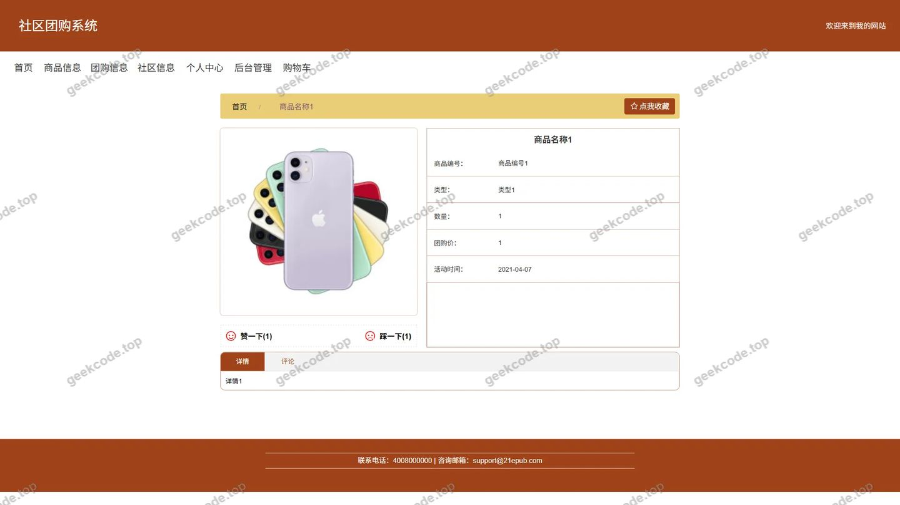</a>

<h4>前台-商品类型列表</h4>

<h4>前台-购物车列表</h4>

<h4>前台-商品信息评论-详情</h4>

<a href="https://geekcode.top/archives/%E5%9F%BA%E4%BA%8Espringboot%E7%9A%84%E7%A4%BE%E5%8C%BA%E5%9B%A2%E8%B4%AD%E7%B3%BB%E7%BB%9F%E8%AE%BE%E8%AE%A1?utm_source=github" title="查看完整源码">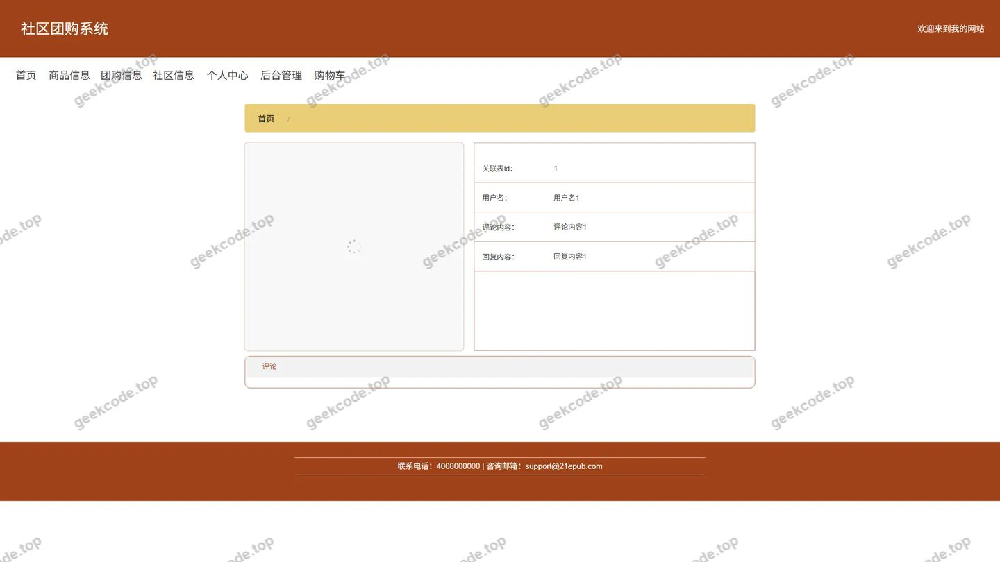</a>

<h4>前台-团购信息评论-详情</h4>

<h4>前台-商品类型-详情</h4>

<a href="https://geekcode.top/archives/%E5%9F%BA%E4%BA%8Espringboot%E7%9A%84%E7%A4%BE%E5%8C%BA%E5%9B%A2%E8%B4%AD%E7%B3%BB%E7%BB%9F%E8%AE%BE%E8%AE%A1?utm_source=github" title="查看完整源码">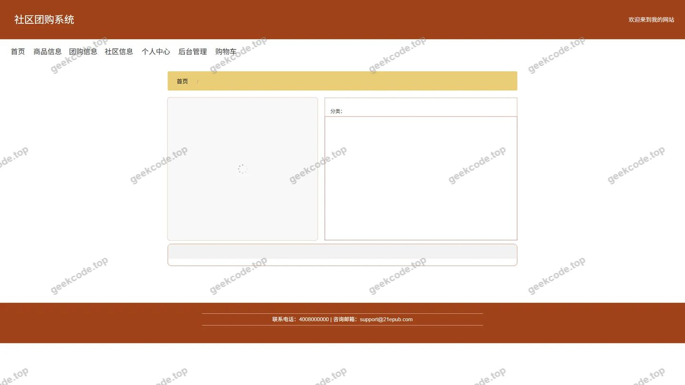</a>

<h3>后台管理端</h3>
<h4>后台-系统配置</h4>

<a href="https://geekcode.top/archives/%E5%9F%BA%E4%BA%8Espringboot%E7%9A%84%E7%A4%BE%E5%8C%BA%E5%9B%A2%E8%B4%AD%E7%B3%BB%E7%BB%9F%E8%AE%BE%E8%AE%A1?utm_source=github" title="查看完整源码">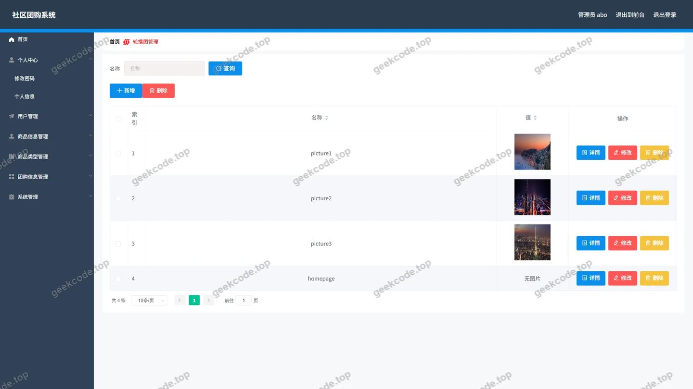</a>

<h4>后台-商品信息评论</h4>

<h4>后台-团购信息评论</h4>

<a href="https://geekcode.top/archives/%E5%9F%BA%E4%BA%8Espringboot%E7%9A%84%E7%A4%BE%E5%8C%BA%E5%9B%A2%E8%B4%AD%E7%B3%BB%E7%BB%9F%E8%AE%BE%E8%AE%A1?utm_source=github" title="查看完整源码">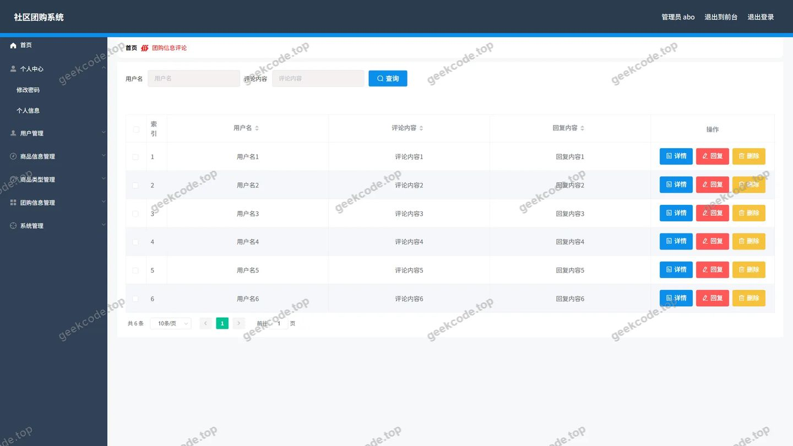</a>

<h4>后台首页</h4>

<a href="https://geekcode.top/archives/%E5%9F%BA%E4%BA%8Espringboot%E7%9A%84%E7%A4%BE%E5%8C%BA%E5%9B%A2%E8%B4%AD%E7%B3%BB%E7%BB%9F%E8%AE%BE%E8%AE%A1?utm_source=github" title="查看完整源码">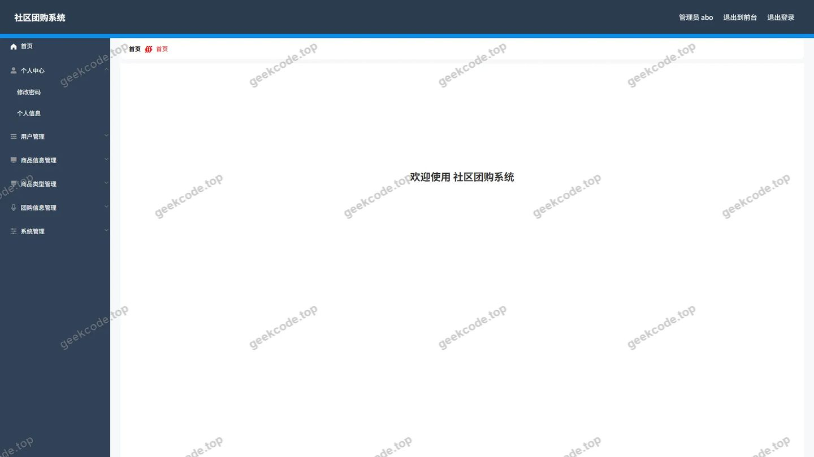</a>

<h4>后台-登录</h4>

<h4>后台-公告信息</h4>

<a href="https://geekcode.top/archives/%E5%9F%BA%E4%BA%8Espringboot%E7%9A%84%E7%A4%BE%E5%8C%BA%E5%9B%A2%E8%B4%AD%E7%B3%BB%E7%BB%9F%E8%AE%BE%E8%AE%A1?utm_source=github" title="查看完整源码">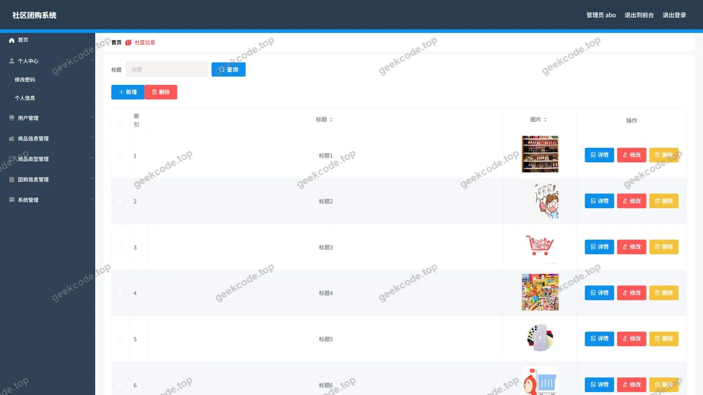</a>

<h4>后台-商品类型</h4>

<a href="https://geekcode.top/archives/%E5%9F%BA%E4%BA%8Espringboot%E7%9A%84%E7%A4%BE%E5%8C%BA%E5%9B%A2%E8%B4%AD%E7%B3%BB%E7%BB%9F%E8%AE%BE%E8%AE%A1?utm_source=github" title="查看完整源码">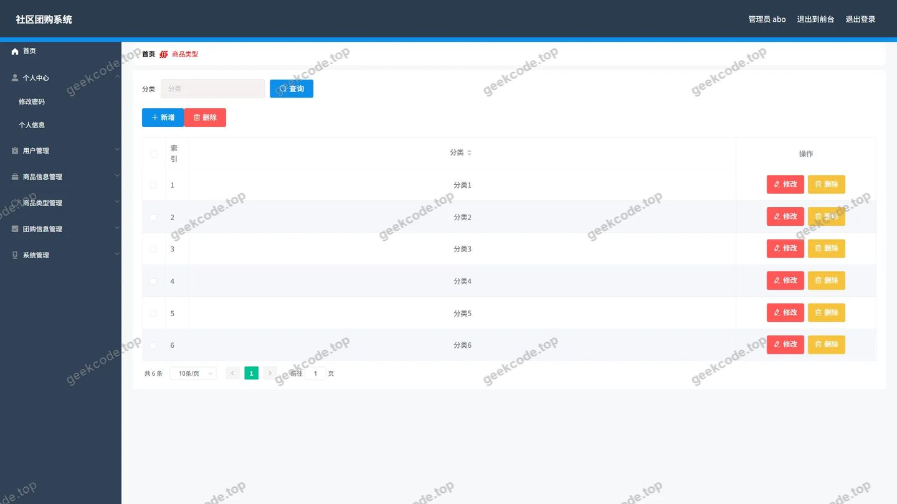</a>

<h4>后台-商品信息</h4>

<a href="https://geekcode.top/archives/%E5%9F%BA%E4%BA%8Espringboot%E7%9A%84%E7%A4%BE%E5%8C%BA%E5%9B%A2%E8%B4%AD%E7%B3%BB%E7%BB%9F%E8%AE%BE%E8%AE%A1?utm_source=github" title="查看完整源码">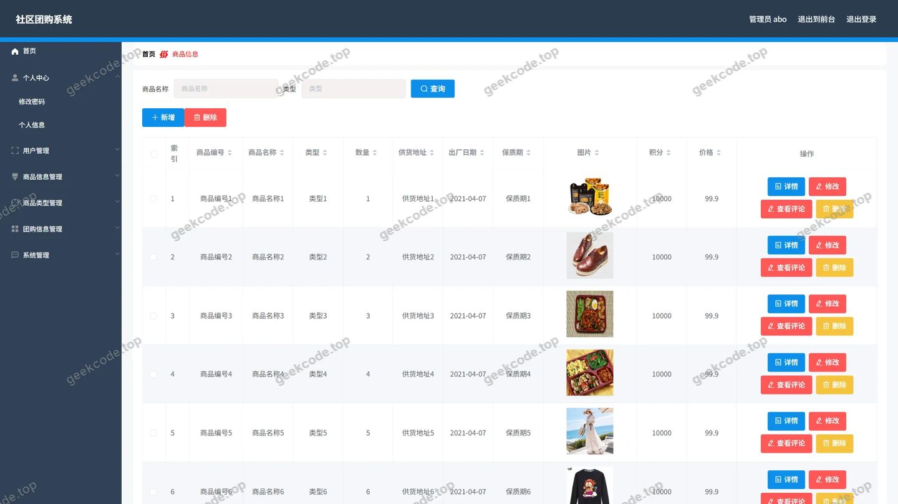</a>

<h4>后台-团购信息</h4>

<a href="https://geekcode.top/archives/%E5%9F%BA%E4%BA%8Espringboot%E7%9A%84%E7%A4%BE%E5%8C%BA%E5%9B%A2%E8%B4%AD%E7%B3%BB%E7%BB%9F%E8%AE%BE%E8%AE%A1?utm_source=github" title="查看完整源码">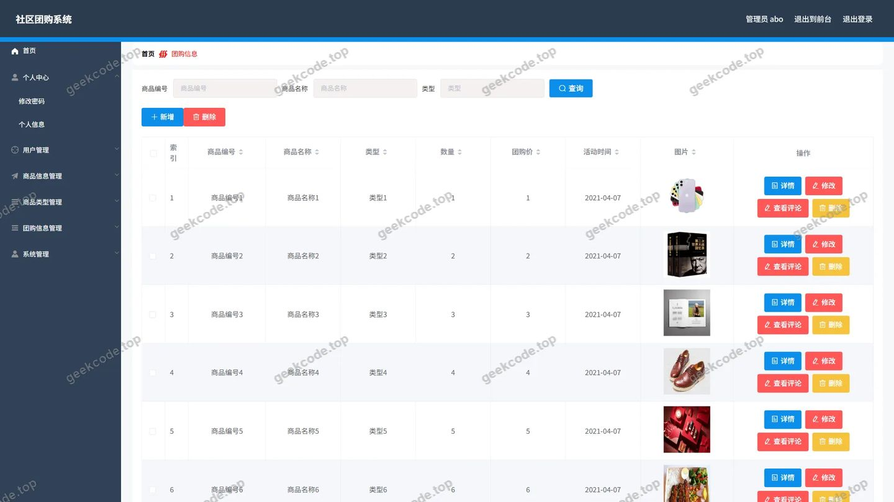</a>

---

## 获取完整源码

| 项目 | 说明 |
| --- | --- |
| 项目名 | 基于springboot的社区团购系统设计 |
| 运行截图 | 本文 29 张（站点带水印原图，仓库 `images/` 目录） |
| 完整源码 | [https://geekcode.top/archives/%E5%9F%BA%E4%BA%8Espringboot%E7%9A%84%E7%A4%BE%E5%8C%BA%E5%9B%A2%E8%B4%AD%E7%B3%BB%E7%BB%9F%E8%AE%BE%E8%AE%A1?utm_source=github](https://geekcode.top/archives/%E5%9F%BA%E4%BA%8Espringboot%E7%9A%84%E7%A4%BE%E5%8C%BA%E5%9B%A2%E8%B4%AD%E7%B3%BB%E7%BB%9F%E8%AE%BE%E8%AE%A1?utm_source=github) |
| 咨询微信 | **ir9372**（备注：jingpin-yuanma） |
| 更多项目 | [极客代码 geekcode.top](https://geekcode.top/?utm_source=github) |

> 需要源码、部署、改配置、跑不起来等问题，加微信 ir9372 沟通，说明项目名即可。
